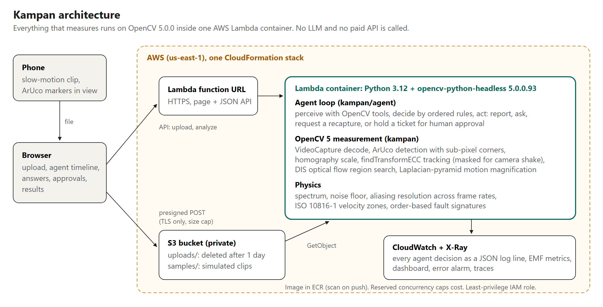
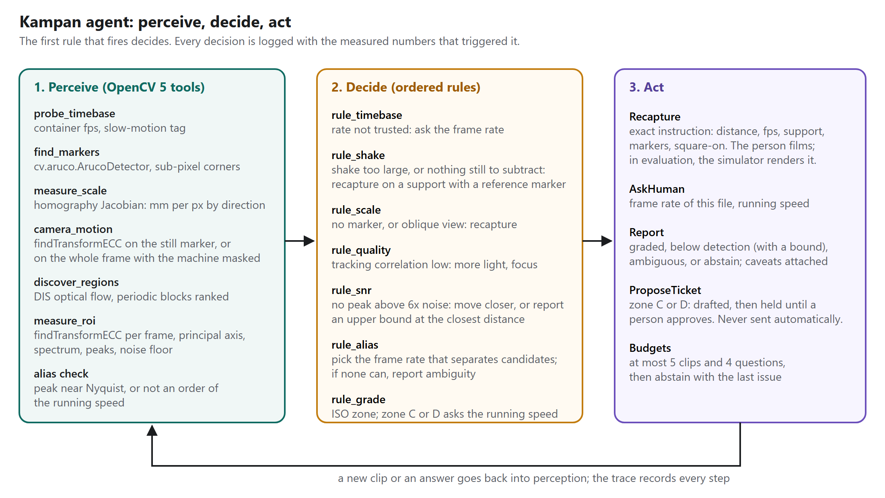

# Kampan: an agent that decides when a phone video can measure vibration

Technical report, OpenCV AI Competition 2026 powered by AWS. Author: Ashwin Goyal.

## 1. Problem

Vibration monitoring catches failing fans, pumps and motors before they break. Accelerometers and route-based analysis
cost money and visits, so most small machines are never measured. A phone can film a machine at 120 or 240 fps, and
OpenCV can track sub-pixel motion in that film. Commercial motion amplification products and research on Eulerian and
phase-based magnification already show that video carries the signal.

The hard part is not extracting a number. It is knowing whether the number is true. A phone capture fails in five
ordinary ways:

1. **Time base:** slow-motion files are often stored at 30 fps with no capture-rate tag, so every frequency is off by 4 or 8 times.
2. **Camera shake:** a hand-held phone moves more than the machine.
3. **Scale:** pixels are not millimetres, and an oblique view compresses one axis.
4. **Noise floor:** at a distance, the motion is smaller than the sensor noise.
5. **Aliasing:** vibration above half the frame rate appears at a false, lower frequency.

A pipeline that ignores these still prints a confident severity. Kampan's contribution is an agent that measures each
condition with OpenCV 5, refuses to grade when one fails, and tells the person what to change in the next capture.

## 2. System

### 2.1 OpenCV 5 tools

| Tool | OpenCV 5 functions | Output |
|---|---|---|
| Marker scale | `aruco.ArucoDetector` (DICT_4X4_50, sub-pixel corner refinement), `getPerspectiveTransform` | mm per pixel along any direction, anisotropy |
| Tracking | `findTransformECC` (translation, warm-started from the previous frame), `GaussianBlur` | x and y displacement per frame |
| Camera motion | ECC on a static reference marker; otherwise ECC on the whole frame with the target masked out | camera track to subtract |
| Region discovery | `DISOpticalFlow` (fast preset), block-averaged | candidate vibrating regions when no marker is present |
| Magnified view | `pyrDown`, `pyrUp`, temporal IIR band-pass | the video judges can see |
| Video input | `VideoCapture`, `resize`; Android capture-rate tag parsed from the MP4 | frames and declared rates |

The spectrum uses a Hann window, zero padding and a median noise floor. A peak counts when it is at least 6 times the
noise floor.

### 2.2 Agent

The agent is a deterministic policy over tool outputs. It uses no LLM and no paid API. Each capture produces an
evidence record, and the rules run in a fixed order:

1. **Time base:** if the frame rate cannot be trusted, ask the human for the capture rate.
2. **Shake:** if camera jitter is large and no static reference is visible, request a braced recapture with marker 1 in view.
3. **Scale:** if marker 0 is missing or too oblique, request a recapture facing the machine with marker 0 in view.
4. **Quality:** if the ECC response is weak, request a recapture with more light or closer framing.
5. **Signal:** if no peak clears the noise floor, request a closer capture. After the capture budget, report "below detection".
6. **Aliasing:** if a peak may be an alias, request a recapture at a rate that separates the candidates. If no phone rate can, ask the running speed.
7. **Grade:** compute velocity RMS from 10 to 1000 Hz and the ISO 10816-1 zone. In zone C or D, ask the running speed for an order diagnosis and propose a maintenance ticket that waits for human approval.

Limits on captures and questions keep the loop bounded. Every tool call, capture, decision and answer goes into a JSON
trace. In the simulator the recapture is rendered; with real clips, the person films it.

### 2.3 AWS

One CloudFormation stack deploys the system.

- **Compute:** a Lambda container image runs Python 3.12 with opencv-python-headless 5.0.0.93, behind a function URL that serves the UI and the API.
- **Storage:** clips go straight from the browser to a private S3 bucket through a presigned POST capped at 300 MB. Uploads expire after one day and the bucket refuses non-TLS access.
- **Operations:** structured JSON logs, embedded metrics, a CloudWatch dashboard, an error alarm and X-Ray tracing.
- **Cost guard:** reserved concurrency of 4.
- **Data:** DynamoDB holds sites, people, machines, readings, tickets and invites. A Secrets Manager key signs the session cookies, and agent traces are stored in S3.

### 2.4 Product

Kampan is used by two roles at a site. A lead signs up with a passkey, registers machines with their ISO class,
running speed and marker size, and invites technicians with one-time links. A technician measures a machine; the
running speed the lead entered is passed to the agent, so it does not ask. Each finished session is saved to the
machine's history with its trace and compared with the previous reading, and a rise of 25% or more is flagged.
In zone C or D the agent drafts a ticket, the technician decides whether to send it, and the lead approves or
declines it. A lead can share a read-only report of a machine without anyone's name.

The server enforces every role and site boundary. The API tests sign up with a software passkey and try the
obvious attacks: the wrong role, another site's machine or upload, a reused invite, an edited cookie, a cross-site
request and a request flood. An end-to-end test drives Chrome with virtual passkeys through the whole loop, and it
passes against the deployed app.

## 3. Evaluation

### 3.1 Agent against a no-check baseline

The simulator renders a textured machine face with ArUco markers, known vibration tones, sensor noise, camera shake,
perspective tilt and the container frame rate a phone would write. Ten scenarios each break one capture condition.
The baseline is the same pipeline in a single pass with no checks. A run is correct when the dominant frequency is
within 3% and the ISO zone matches the truth, or when a still machine is reported as still.

| | Correct | Confidently wrong | Abstained |
|---|---|---|---|
| Agent | 30/30 | 0 | 0 |
| Baseline | 15/30 | 12 | 3 |

Per-scenario results are in [results/agent_vs_baseline.md](results/agent_vs_baseline.md). The baseline fails exactly
where a capture condition is broken: untagged slow motion, hand shake with and without a reference, aliasing and a
missing marker. The agent recovers each case with at most two recaptures and two questions.

### 3.2 Measurement accuracy

| Noise (grey levels) | Amplitude (px) | Detected | Median frequency error (Hz) | Median amplitude error |
|---|---|---|---|---|
| 1 | 0.005 | 12/12 | 0.002 | 2.9% |
| 1 | 0.01 | 12/12 | 0.001 | 1.2% |
| 1 | 0.05 | 12/12 | 0.000 | 4.9% |
| 1 | 1 | 12/12 | 0.000 | 0.3% |
| 3 | 0.005 | 12/12 | 0.003 | 7.4% |
| 3 | 0.01 | 12/12 | 0.002 | 4.9% |
| 3 | 0.05 | 12/12 | 0.001 | 2.7% |
| 3 | 1 | 12/12 | 0.000 | 0.2% |

Selected rows; the full grid is in [results/measurement.md](results/measurement.md). Amplitudes are peak displacement
in pixels at 240 fps, over 2 s. Frequencies tested: 8, 21, 47 and 95 Hz, 3 seeds each.

Every amplitude in the grid was detected. That says more about the simulator than about phones: its sensor noise is
independent per pixel, so averaging over the tracked patch removes most of it. Real clips add compression artefacts,
rolling shutter and lighting flicker, which are correlated across the patch. The real detection limit has to come from
real clips, and the agent's noise-floor check is what protects a reading in the meantime.

### 3.3 Tracker choice

| Texture feature size | phaseCorrelate + Hann | phaseCorrelate | findTransformECC |
|---|---|---|---|
| 1 px | 40% | 14% | 12% |
| 2 px | 34% | 22% | 7% |
| 4 px | 102% | 70% | 7% |

Median absolute error of the sub-pixel shift over 0.05, 0.1 and 0.3 px shifts. Full table:
[results/estimators.md](results/estimators.md). Phase correlation's sub-pixel estimate depended on texture scale and
halved horizontal motion on coarse texture. ECC stayed within 7 to 12%, so Kampan tracks with ECC.

### 3.4 OpenCV behaviour found along the way

`cv2.phaseCorrelate` with a window argument modifies both input arrays in place. Calling it twice on the same arrays
gives a different answer the second time. The same happens in OpenCV 4.12.0 and 5.0.0, so it is not new in 5.0.
Kampan passes copies. The check is in `eval/check_phasecorrelate_inplace.py`.

## 4. Failure cases and limits

These are the ways Kampan failed during development or still can.

- **Oblique view, before the tracker change:** with phase correlation the agent graded a 60-degree view of horizontal vibration into the wrong zone, because the tracker under-read horizontal motion. Switching to ECC fixed it in the benchmark.
- **Alias forgotten after recapture:** an early policy cleared the alias suspicion when the second clip looked clean, and graded the false frequency. The policy now carries alias suspicion across the capture history.
- **Shake subtraction adding noise:** subtracting a camera track that was mostly noise cancelled a small real signal in the far scenario. Kampan now subtracts camera motion only when jitter exceeds 0.05 px.
- **Phase correlation lost small motion:** with the earlier tracker, 0.005 px was not detected at either noise level and 0.01 px was lost at the higher noise. ECC detects both in simulation. On real clips, when no peak clears the noise floor, the agent reports "below detection" and asks for a closer capture rather than guessing.
- **Simulated noise is too kind:** see section 3.2. Simulation accuracy is an upper bound.
- **Phone frame rates cannot separate every alias:** 30, 60, 120 and 240 fps all divide 240, so a tone at f and one at 240 minus f look identical at every phone rate. The agent then asks for the running speed instead of grading.
- **Out-of-plane motion is invisible:** a camera sees motion across the image only.
- **Exposure blur:** if the shutter stays open for the whole frame, amplitude at high frequency is reduced. At 240 fps that is about 26% at 100 Hz. The report states the possible loss.
- **Velocity bias on one sample:** on the unbalanced sample the web app read 3.52 mm/s against a true 3.35 mm/s. This is one case, not a measured bias.
- **Simulated recaptures:** in the benchmark the simulator renders each recapture. Real performance depends on how well a person follows the instruction.
- **Screening, not certification:** ISO 10816-1 zones are applied to a camera estimate. It is a screening signal for whether to call a technician.

## 5. Reproducing

Instructions are in the [README](../README.md). The test suite, all three benchmarks and the deployment run from the repository.

## 6. References

- ISO 10816-1:1995, Mechanical vibration: evaluation of machine vibration by measurements on non-rotating parts.
- H.-Y. Wu et al., Eulerian Video Magnification for Revealing Subtle Changes in the World, SIGGRAPH 2012.
- N. Wadhwa et al., Phase-Based Video Motion Processing, SIGGRAPH 2013.
- G. Evangelidis and E. Psarakis, Parametric Image Alignment Using Enhanced Correlation Coefficient Maximization, IEEE TPAMI 2008.
- T. Kroeger et al., Fast Optical Flow Using Dense Inverse Search, ECCV 2016.
- S. Garrido-Jurado et al., Automatic generation and detection of highly reliable fiducial markers under occlusion, Pattern Recognition 2014.
